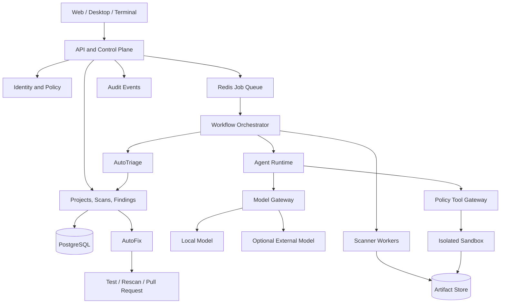

# CYBER SKY — Master Project Document

> **A self-hosted-first, AI-driven cybersecurity platform for continuously securing software, cloud environments and developer workflows.**
>
> **Status:** Living product and engineering source of truth  
> **Academic context:** CMP6200 Final-Year Project · BSc (Hons) Computer Science with Artificial Intelligence · Birmingham City University  
> **Project model:** Individual developer; approximately 40 hours/week stated as available  
> **Last updated:** 25 November 2026

---

## 1. Executive overview

Cyber Sky is a proposed unified cybersecurity platform that helps organisations discover, understand, validate, prioritise and remediate security risks across software development and supporting infrastructure. Its central proposition is to move security from fragmented, periodic checks towards a continuous, evidence-led workflow integrated with repositories, CI/CD pipelines and developer environments.

The platform combines established security scanners with an agentic AI layer. Deterministic tools provide specialist detection; AI agents correlate context, investigate selected findings in authorised environments, explain risk and prepare remediation proposals. Human approval remains the default control point for consequential changes.

A defining product principle is **self-hosted first**. Organisations should be able to run the platform and model inference inside infrastructure they control, keeping source code, findings and infrastructure metadata private. External frontier-model providers may be enabled as an explicit, policy-governed option.

The long-term vision includes a web control plane, desktop client, terminal harness for authorised vulnerability and security penetration testing (VSPT), CI/CD integrations, developer workstation protection, application security posture management (ASPM), cloud security posture management (CSPM), and runtime security capabilities. The CMP6200 implementation must deliver a measurable and safe subset—not claim every long-term capability is complete.

**Core message:** attackers increasingly automate; defensive software security needs to become continuous, contextual and faster.

## 2. Vision, mission and principles

### 2.1 Vision
Create one trusted platform that gives software organisations a practical way to protect applications and infrastructure using automation and agentic AI, without surrendering control of sensitive engineering data.

### 2.2 Mission
Reduce the time and effort between a software change introducing a weakness and the organisation understanding, validating and safely addressing it.

### 2.3 Principles
1. **Customer control:** self-hosting and local inference are first-class options.
2. **Evidence over confidence:** AI conclusions must reference scanner output, source locations, test traces or other inspectable evidence.
3. **Tools plus reasoning:** use established scanners for detection and AI for context, investigation and workflow assistance.
4. **Human-governed changes:** no automatic production changes or merges by default.
5. **Safe by design:** least privilege, isolation, allowlists, timeouts and audit logs.
6. **Plug-and-play integration:** integrate with existing repositories, pipelines and infrastructure.
7. **Incremental autonomy:** progress from read-only analysis to bounded validation and reviewed remediation.
8. **Interoperability:** documented APIs, standard formats and replaceable integrations.
9. **Measurable outcomes:** evaluate precision, recall, validation quality, remediation success, latency and resource use.
10. **Honest claims:** scanner alert, AI hypothesis, confirmed vulnerability and successfully remediated issue are different states.

## 3. Problem definition

### 3.1 Security-speed gap
Software is delivered continuously, but security processes can remain periodic and fragmented. Teams may run SAST, DAST, software composition analysis (SCA), secrets and infrastructure scans at different points, then manually deduplicate and investigate results. Findings can be noisy, difficult to prioritise and disconnected from the code change or runtime context that produced them.

AI-assisted attackers can use language models and tools to interpret advisories, plan multi-step activity and assist exploitation. This does not mean every vulnerability can be exploited autonomously; it does mean the time available to respond can shrink.

### 3.2 Customer pain points
- Large volumes of findings, including duplicates and false positives.
- Security expertise is expensive and difficult for small teams to maintain.
- Separate tools create fragmented workflows and inconsistent data.
- Findings often lack exploitability context and business prioritisation.
- Remediation is manual and disconnected from detection.
- Dependency/package installation can introduce supply-chain risk.
- Organisations may not want proprietary code, credentials or infrastructure data sent to third-party AI providers.
- Legacy and modern systems use different languages, frameworks and deployment models.

### 3.3 Problem statement
Software organisations need a secure, integrated and privacy-conscious way to continuously identify and investigate vulnerabilities, distinguish actionable risk from noise, and accelerate remediation without losing control of sensitive engineering data.

### 3.4 CMP6200 research focus
**Research question:** To what extent can an agentic AI layer integrated with established security scanners and operated under explicit safety controls improve vulnerability validation and remediation workflows compared with raw scanner output?

Supporting questions:
- Can contextual validation reduce false positives without materially increasing false negatives?
- Can role-separated agents maintain useful context during multi-step investigation?
- Can generated remediation proposals pass relevant tests at a useful rate?
- What latency and compute overhead does the workflow add to CI?
- How practical is local inference for sensitive security workflows?

## 4. Customers, users and jobs-to-be-done

### 4.1 Initial customer segments
1. Startups and small software companies without a dedicated application-security team.
2. Mid-sized SaaS businesses with frequent releases.
3. Software development agencies managing client codebases.
4. Selected larger organisations requiring self-hosted security automation.
5. DevSecOps, platform engineering and application-security teams.

### 4.2 User roles

| Role | Needs |
|---|---|
| Organisation owner | Deployment control, integrations, policy, cost and risk visibility |
| Security administrator | Findings, evidence, triage, audit and remediation governance |
| Developer | Actionable issues, source locations, safe fixes and low workflow friction |
| Platform/DevOps engineer | CI integration, runners, secrets and infrastructure controls |
| Auditor | Traceability, policy history and exportable evidence |

### 4.3 Jobs to be done
- When code changes, identify security issues quickly.
- Explain which findings are genuinely exploitable and why.
- Show evidence and context behind prioritisation.
- Prepare a fix that developers can review and test.
- Keep sensitive data within customer-controlled infrastructure.
- Provide one place to understand application and infrastructure security posture.

## 5. Product capability map

### 5.1 ASPM
Aggregate and contextualise application security findings across repositories, projects, environments and pipelines. Capabilities include repository inventory, finding normalisation, deduplication, ownership, risk views, trends and remediation tracking.

### 5.2 Scanner orchestration
Invoke existing tools and convert outputs into a canonical finding model. Initial candidates:
- **Semgrep:** static application security testing (SAST).
- **OWASP ZAP:** dynamic application security testing (DAST), only against authorised targets.
- **Trivy:** container, filesystem, dependency and selected configuration scanning.
- **Gitleaks:** secret detection.
- **Additional capability:** choose a fifth based on a documented coverage gap.

The presentation refers to a long-term 30+ scanner ambition and an MVP target of at least five scanner capabilities. Do not claim a count until integrations are working and tested; document whether a capability is a separate tool or a mode of an existing tool.

### 5.3 Agentic pentesting / validation
Investigate selected findings and determine whether a plausible exploit path can be demonstrated safely. The agent receives a scoped finding, plans bounded validation steps, uses allowlisted tools through a policy gateway and returns a reproducible evidence-backed verdict: confirmed, likely, inconclusive, not reproducible or blocked by policy.

This is not unrestricted autonomous hacking. Testing is limited to owned or explicitly authorised targets, preferably isolated labs such as OWASP Juice Shop or DVWA.

### 5.4 AutoTriage
Rank and explain findings using scanner confidence, asset criticality, reachability, exposure, validation evidence, data sensitivity and compensating controls. Outputs include priority, rationale, confidence, uncertainty, owner suggestion and next action. Preserve raw scanner severity and source evidence separately.

### 5.5 AutoFix
Prepare candidate remediation changes:
1. Retrieve minimum required code context.
2. Generate a minimal patch.
3. Run formatting, unit/integration tests and relevant security scans.
4. Capture diff and test evidence.
5. Create a branch or pull request.
6. Require authorised human review and approval before merge.

A patch that compiles is not automatically secure.

### 5.6 Developer Workstation Guard
The presentation proposes screening npm and pip package installation. A limited proof of concept can inspect package identity/version, check known advisories or malicious-package indicators and apply allow/warn/block policy. It must be transparent, auditable, privacy-respecting and explicit about offline/fail-open/fail-closed behaviour. It is not full endpoint protection.

### 5.7 CSPM and IaC
Long-term capabilities may assess cloud assets, identity and access settings, network exposure, container/Kubernetes configuration, infrastructure-as-code and configuration drift. IaC scanning may be included in the MVP through existing tools.

### 5.8 Runtime Guard
Long-term runtime detection or prevention requires its own threat model, telemetry integrations, performance tests and failure-mode analysis. It is not assumed to be part of the minimum academic deliverable.

### 5.9 Terminal harness for VSPT
A terminal-first security workspace for authorised assessment, with tool integrations, agent plans, evidence and repeatable workflows. Enforce target scope, allowlisted tools, sandboxing, resource limits, human confirmation for intrusive actions and complete audit trails.

### 5.10 Web and desktop
- **Web:** primary control plane for organisations, projects, findings, policies, integrations, jobs and reports.
- **Desktop:** optional local companion for notifications and workstation workflows.
- **Terminal:** specialist interface for authorised testing and developer workflows.
All clients should use shared backend APIs rather than duplicate security logic.

## 6. Product vision versus academic MVP

| Capability | Long-term vision | CMP6200 priority |
|---|---|---|
| Web control plane | Full multi-tenant product | Basic project, scan and finding experience |
| Scanner integrations | 30+ target | Five defined capabilities where feasible |
| Agentic validation | Many stacks and target types | One bounded lab workflow |
| AutoTriage | Enterprise-wide risk | Evidence-linked prioritisation |
| AutoFix | Many languages/frameworks | Patch proposal, tests and human-reviewed PR |
| Workstation guard | Multiple ecosystems | npm/pip proof of concept if time permits |
| CSPM | Multi-cloud posture | Optional IaC scanning |
| Runtime Guard | Continuous runtime protection | Future work unless narrow demonstrator feasible |
| Desktop/terminal | Full clients | Not a blocker for core MVP |

**Scope rule:** complete one reliable end-to-end workflow before expanding module count or client surfaces.

## 7. Core user journeys

### 7.1 Repository onboarding
1. Administrator creates workspace.
2. Connects repository or self-hosted runner.
3. Reviews requested permissions and data flows.
4. Selects scanners, policies and model deployment.
5. Runs a connectivity test.
6. Project becomes onboarded with auditable configuration.

### 7.2 Commit / pull-request workflow
1. Commit or PR triggers CI.
2. Scanner adapters run configured tools.
3. Raw reports are stored and findings normalised.
4. Findings are deduplicated/correlated.
5. Policy selects eligible findings for validation.
6. Agent tests only within approved scope.
7. AutoTriage explains and prioritises.
8. AutoFix may prepare a patch and run tests.
9. Human reviews PR.
10. Results, approvals and audit events are retained.

### 7.3 Investigation and remediation
Users inspect original scanner details, request bounded investigation, review evidence and uncertainty, then request a patch proposal. The patch is tested in an isolated workspace and presented as a reviewable diff. Human approval is required before merge.

## 8. AI autonomy model

| Level | Behaviour | Control |
|---|---|---|
| L0 | Read-only analysis | No side effects |
| L1 | Recommendations | User review |
| L2 | Bounded sandbox validation | Policy + isolation + audit |
| L3 | Patch and PR proposal | Human approval |
| L4 | Limited automatic actions | Explicit opt-in, strict policy, rollback |
| L5 | Continuous detect/validate/remediate/monitor | Long-term ambition; requires proven safeguards |

The FYP should prioritise L0–L3. L4/L5 are product ambitions, not claims about current implementation.

## 9. Privacy, security and ethics

Potential sensitive data includes source code, scanner output, credentials accidentally committed, infrastructure metadata, test traces and prompts/responses.

Requirements:
- Customer-controlled deployment and local model endpoints.
- External models disabled unless explicitly configured.
- Display which data classes are sent to each provider.
- Minimise context and redact secrets before inference.
- Encrypt data in transit and at rest.
- Use RBAC, least-privilege service identities and scoped repository tokens.
- Audit scans, tool calls, policy changes and approvals.
- Restrict agent network egress and sandbox privileges.
- Apply rate limits, quotas, timeouts and output-size limits.
- Define retention, deletion, backup and restore procedures.
- Treat repository files, package metadata, scanner output and web content as untrusted input; never let them modify system instructions or permissions.

Ethical/legal boundaries:
- Test only owned or explicitly authorised assets.
- Use intentionally vulnerable lab applications.
- Do not use real customer credentials or production data in academic evaluation.
- Avoid destructive, persistence, credential theft or denial-of-service activity.
- Require human approval for code changes and consequential actions.
- Explain that AI output can be wrong and does not guarantee security.

## 10. High-level architecture

The system uses a modular API-first control plane, asynchronous jobs, scanner/agent workers, a model gateway, a policy-enforced tool gateway and isolated execution environments. PostgreSQL stores core transactional data; object storage holds large raw reports and evidence artefacts.

See `System-Architecture.md` for detailed components, flows, data model, trust boundaries and design rationale.

## 11. Conceptual data entities

| Entity | Purpose |
|---|---|
| Organisation / User / Membership | Tenant and identity model |
| Role / Permission | RBAC and scope |
| Project | Repository/application configuration |
| Integration | Git, CI, scanner and notification connections |
| Scan / ScannerRun | Trigger, status, commit, tool version and execution |
| Finding | Normalised vulnerability and lifecycle |
| FindingEvidence | Raw output reference, source location, trace |
| FindingRelationship | Duplicate, dependency or correlation link |
| AgentRun / ToolExecution | Agent role, model/config, tool and policy decision |
| ValidationResult | Verdict, confidence, reproducibility and evidence |
| RemediationProposal | Patch reference, tests and review state |
| Policy | Scan, validation, data and autonomy rules |
| AuditEvent | Actor, action, target, time and result |

Begin with a small relational model. Add another database only when a demonstrated workload requires it.

## 12. Technology direction

- Backend: Bun + Hono or Elysia.
- Frontend: Next.js + React + TypeScript; shadcn/ui and supporting libraries.
- Data: PostgreSQL + Prisma; MongoDB/Mongoose only if justified.
- Background processing: Redis; Kafka only when required.
- AI orchestration: LangGraph and/or Google/Vercel AI SDKs behind provider adapters.
- Infrastructure: Docker; Kubernetes when scale/operations justify it.
- Desktop: Tauri v2.
- Terminal: Bun + OpenTUI.
- Performance-specific services: Rust or Go only when profiling justifies them.
- Security integrations: Semgrep, OWASP ZAP, Trivy, Gitleaks and selected additional tools.

These are proposed choices, not a requirement to use every technology. See `Tech-Stack.md`.

## 13. Quality attributes

- **Security:** least privilege, tenant isolation, safe execution and auditability.
- **Privacy:** local inference, data minimisation and configurable retention.
- **Reliability:** durable jobs, retries, idempotency and recoverable workers.
- **Performance:** asynchronous scans and bounded agent execution.
- **Scalability:** stateless API where possible and independently scalable workers.
- **Maintainability:** typed contracts, modular adapters, migrations and tests.
- **Portability:** containerised deployment and documented configuration.
- **Observability:** structured logs, metrics, traces and job diagnostics.
- **Usability:** explainable findings, visible uncertainty and actionable fixes.

## 14. Evaluation and proposed success criteria

The presentation defines these as **targets, not achieved results**:

| Measure | Proposed target | Evaluation |
|---|---:|---|
| False-positive reduction | ≥70% vs raw scanner output | Label benchmark and compare actionable false positives |
| AutoFix test success | ≥60% of generated patches | Run tests in reproducible containers |
| Malicious package detection | ≥90% on selected benchmark | Documented safe malicious/benign package dataset |
| CI overhead | <10 minutes added per build | Repeated baseline vs Cyber Sky runs |

Also measure precision, recall, false-negative rate, validation reproducibility, agent runtime/cost, scan failures, time-to-validated-result, human patch acceptance and local model resource consumption.

Record dataset provenance, labels, environment, tool/model versions, prompts/configuration, repeated trials and limitations. Never report a target as achieved without evidence.

## 15. Development methodology and phases

Use two-week Agile sprints:
1. Define a user-visible outcome and acceptance criteria.
2. Confirm threat model and data boundary.
3. Implement a small vertical slice.
4. Add unit, integration and security tests.
5. Run benchmark cases.
6. Review failures and update design.
7. Document decisions and unfinished work.

Indicative phases: product definition; architecture; foundation; scanner orchestration; AI validation; AutoTriage; AutoFix; workstation proof of concept; evaluation/hardening; commercial validation. The presentation describes a 21-week plan, but its narration includes later evaluation milestones. Align dates with the actual university calendar.

## 16. Risks and mitigations

| Risk | Mitigation |
|---|---|
| AI misses real issue | Preserve raw findings; benchmark recall; human review |
| Hallucinated exploitability | Require evidence; allow inconclusive verdict |
| Prompt injection | Treat retrieved content as untrusted; policy tool gateway |
| Unsafe testing | Lab-only targets, allowlists, isolation and timeouts |
| Unsafe patch | Minimal diff, tests, rescan and human approval |
| Local model limitations | Benchmark, quantise or allow approved external provider |
| Integration complexity | Adapter contracts and prioritised vertical slices |
| Scope creep | Finish core CI workflow before extra clients/modules |
| Data exposure | Self-hosting, redaction, encryption and retention controls |
| Scanner/worker failure | Version pinning, retries and explicit failure states |
| Compute limits | Concurrency limits, measured capacity and workload separation |

## 17. Commercial direction

Positioning hypothesis: a self-hosted-first application security and DevSecOps platform connecting detection, validation and remediation.

Potential differentiation hypotheses to validate:
- Local model inference and customer-controlled deployment.
- Unified workflow rather than another isolated scanner.
- Evidence-backed validation to reduce alert noise.
- Developer-integrated remediation proposals.
- Plug-and-play integration with existing systems.

Potential models: self-hosted subscription, enterprise licence/support, optional managed cloud, usage-based scan/agent tiers and professional integration services.

Initial go-to-market hypothesis: UK startups and small-to-mid-sized SaaS companies, gather pilot feedback, improve onboarding and value, then consider international expansion. Competitor research and customer interviews are required before making comparative claims.

## 18. Open decisions

- Hono or Elysia.
- Prisma and whether MongoDB is necessary.
- Redis queue implementation and whether Kafka is justified.
- Local inference runtime and supported models.
- Modular monolith versus later service extraction.
- Exact fifth scanner capability and supported tool versions.
- First Git provider and CI platform.
- MVP inclusion of desktop and terminal clients.
- Package guard interception method and OS support.
- Tenant model, licensing and deployment topology.

## 19. Definition of done

A feature is complete when requirements and acceptance criteria are documented; permissions and threat boundaries are defined; schemas are validated; tests pass; failure and timeout paths are handled; logs do not leak secrets; UI states are understandable; documentation is updated; and a reproducible demonstration exists where relevant.

## 20. Glossary

- **ASPM:** Application Security Posture Management.
- **CSPM:** Cloud Security Posture Management.
- **SAST / DAST:** Static / Dynamic Application Security Testing.
- **SCA:** Software Composition Analysis.
- **IaC:** Infrastructure as Code.
- **CI/CD:** Continuous Integration / Continuous Delivery or Deployment.
- **VSPT:** Vulnerability and Security Penetration Testing (project terminology).
- **AutoTriage:** Evidence-informed grouping, prioritisation and explanation.
- **AutoFix:** Generation and testing of a proposed remediation.
- **Self-hosted-first:** Core platform and inference can run in customer-controlled infrastructure.

---

**Maintenance:** Update this document whenever product boundaries, major technical decisions, safety policy, evaluation targets or delivery commitments change. Record material decisions in architecture decision records (ADRs).
