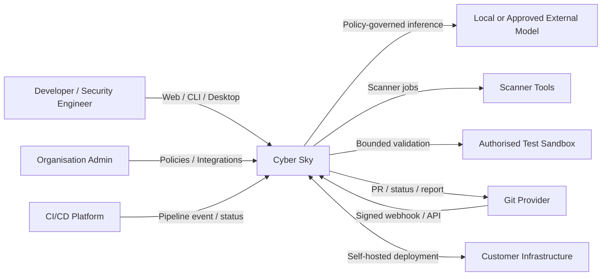
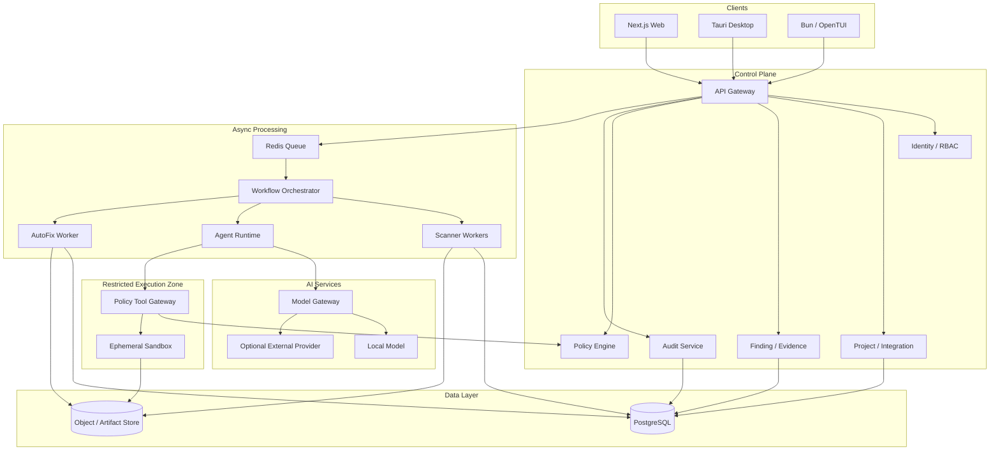
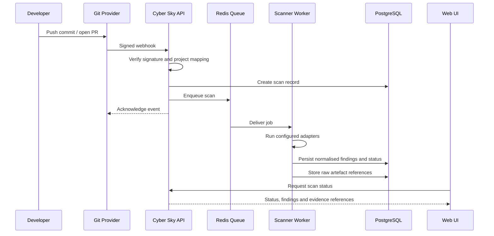
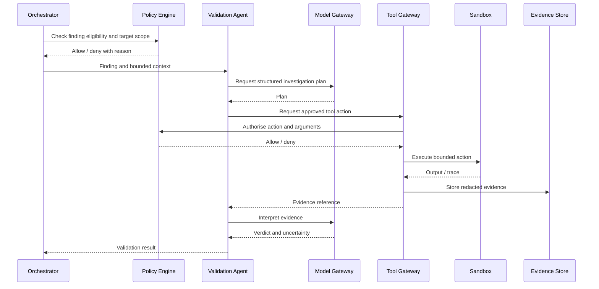
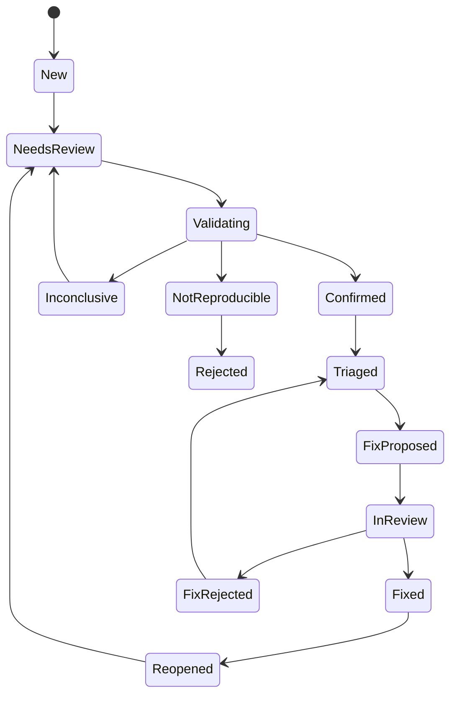
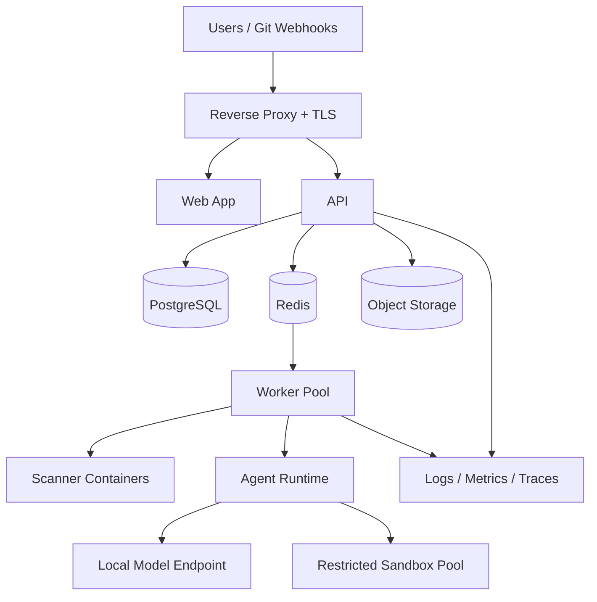

# CYBER SKY — System Architecture and Design

> **Architecture style:** Modular, API-first control plane with asynchronous workers, replaceable integrations and isolated execution environments.  
> **Status:** Proposed target architecture. Validate through implementation and record material decisions in ADRs.

## 1. Architecture goals

Cyber Sky must support a continuous security workflow without creating an unrestricted autonomous system or requiring customers to surrender control of sensitive data.

Goals:
1. Integrate with existing repositories and CI/CD.
2. Orchestrate multiple specialist scanners.
3. Preserve raw findings while normalising/correlating results.
4. Use AI to investigate and explain findings with evidence.
5. Execute validation only within explicit authorisation boundaries.
6. Generate tested remediation proposals for human review.
7. Support local/self-hosted models and optional external providers.
8. Scale scan/agent workloads independently from API.
9. Provide auditable, recoverable workflows.
10. Allow web, desktop and terminal clients to share backend capabilities.

## 2. Core design decisions and rationale

### 2.1 Modular monolith first; workers separated by workload
**Decision:** Begin with a modular backend/control plane and separate worker processes for long-running or risky jobs. Do not split every domain into a network microservice immediately.

**Why:** A solo developer can build/debug a modular codebase more efficiently. A modular monolith avoids premature service discovery and distributed transactions. Scanner and sandbox workloads have different resource and trust requirements, so they should run outside the API process. Modules can be extracted later when independent scaling or isolation warrants it.

### 2.2 Asynchronous execution
Scans, validation and remediation are queued. Security jobs can take seconds or minutes; API requests should remain short. Durable job state enables progress, retries, cancellation, recovery and independent worker scaling.

### 2.3 PostgreSQL as source of truth
Core entities are relational and need constraints, transactions and tenant scoping. PostgreSQL JSONB can store selected flexible metadata. Raw reports and large evidence bundles belong in object storage with references in the database.

### 2.4 Scanner adapters, not custom scanner engines
Established tools already implement specialist detection. Cyber Sky's differentiating layer is orchestration, evidence validation, context, triage and remediation. A common adapter contract makes tools replaceable and raw output auditable.

### 2.5 AI is an evidence-informed workflow layer
Models are probabilistic and can hallucinate. Deterministic tools remain responsible for specialist detection. AI supports context synthesis, investigation planning, explanation and patch proposals. A separate policy gateway authorises every tool action.

### 2.6 Self-hosted-first model gateway
Sensitive source and security data may not be suitable for third-party processing. Customer-controlled inference provides control over data flows; external providers remain optional and explicit. Provider abstraction avoids vendor lock-in.

### 2.7 Human approval for consequential changes
Default behaviour is patch proposal and pull request, not automatic merge/deployment. AI patches can introduce regressions. Human review provides accountability while tests and evidence reduce review effort.

## 3. System context

Cyber Sky can run within customer infrastructure. It connects to code hosting and CI using scoped credentials. Scanner and validation jobs run in controlled workers. Model requests follow organisation policy.

## 4. Logical component architecture

### Component responsibilities

| Component | Responsibilities | Must not do |
|---|---|---|
| API gateway | Auth context, validation, routing, rate limits | Run long scans synchronously |
| Identity/RBAC | Users, memberships, permissions and scope | Trust client-supplied tenant IDs |
| Project service | Repository/project config and integration metadata | Store unprotected credentials |
| Scanner workers | Invoke tools, parse results, store artefacts | Access unrelated tenant projects |
| Orchestrator | Job state, dependencies, retries and checkpoints | Bypass policy |
| Agent runtime | Bounded reasoning workflows | Execute arbitrary shell/network actions |
| Model gateway | Route to permitted models and apply data policy | Silently send private data externally |
| Tool gateway | Authorise/validate every tool call | Accept unrestricted command strings |
| Sandbox controller | Create/destroy isolated workspaces | Expose privileged host access |
| AutoTriage | Correlate, explain and prioritise evidence | Delete raw findings |
| AutoFix | Generate candidate patch and run tests | Merge/deploy without approval |
| Audit service | Record security-relevant actions | Log secrets or unnecessary source |
| Clients | Present workflows and collect user intent | Enforce policy only in UI |

## 5. Main data flows

### 5.1 Repository onboarding
1. User authenticates.
2. Creates organisation/project.
3. Connects repository using scoped OAuth app or deploy key.
4. Backend validates connection and stores secure credential reference.
5. User selects scanners, policies and model mode.
6. Cyber Sky runs connectivity test.
7. Audit event records integration and permissions.

Onboarding must request minimum repository scopes and make permissions/data flows visible.

### 5.2 Commit / pull-request scan

Requirements:
- Verify webhook signatures and guard against replay.
- Make webhook processing idempotent.
- Bind scan to commit SHA, branch and PR.
- Distinguish scanner failure from a clean scan.
- Preserve raw report, tool version and configuration.

### 5.3 Agentic validation

The model cannot execute arbitrary commands directly. It proposes typed tool calls; the gateway independently validates actor, target, arguments, permission and resource limits.

### 5.4 AutoTriage
1. Receive raw scanner finding and evidence.
2. Resolve project, asset and commit context.
3. Find duplicates and related findings.
4. Retrieve validation result if available.
5. Apply deterministic factors such as exposure and asset criticality.
6. Request structured model explanation where useful.
7. Validate output and evidence references.
8. Store priority, rationale, confidence and uncertainty.
9. Show result beside original scanner details.

Risk scores should be explainable and versioned. Do not imply precision when context is missing.

### 5.5 AutoFix
1. User/policy requests proposal.
2. Check permission and retrieve minimum source context.
3. Generate minimal patch.
4. Apply in disposable workspace.
5. Run formatter, tests and relevant scans.
6. Compare findings and capture logs.
7. Create branch/PR if policy passes.
8. Human reviews and decides whether to merge.
9. Update finding after verified remediation.

### 5.6 Package screening
1. Developer requests package installation.
2. Guard obtains package name, version, source and lockfile context.
3. Policy checks advisories and selected malicious-package indicators.
4. Return allow/warn/block.
5. Record decision and evidence.
6. Permit explicit override only if policy allows.

Implementation depends on OS/package manager. It must be transparent and avoid unrelated workstation monitoring.

## 6. Data architecture

### 6.1 PostgreSQL entities
- Organisations, users and memberships.
- Projects and integrations.
- Policies and permissions.
- Scans and scanner runs.
- Normalised findings and relationships.
- Agent runs and validation results.
- Remediation proposals and approvals.
- Audit events and workflow metadata.

### 6.2 Object storage
Raw scanner reports, redacted tool output, evidence bundles, traces, patch artefacts and exports. Store object references and checksums in PostgreSQL. Apply encryption, access control and retention.

### 6.3 Finding lifecycle

Keep scanner source status and Cyber Sky workflow status distinct. “Not reproducible” is not proof that a vulnerability does not exist.

### 6.4 Integrity and retention
- Store checksums for raw artefacts.
- Make audit events append-only where feasible.
- Apply configurable retention to source-derived evidence.
- Support tenant offboarding and deletion.
- Avoid logging secrets and raw code by default.
- Test migrations, backup and restore.

## 7. Agent design and autonomy

### Roles
- **Coordinator:** selects workflow and manages state.
- **Finding analyst:** interprets scanner output and gathers context.
- **Validation agent:** proposes bounded test actions and interprets evidence.
- **Remediation agent:** proposes minimal patch and test plan.

Role separation is intended to reduce context overload and improve testability; it does not guarantee correctness.

### Agent contract
Every run defines purpose, allowed task, input schema, evidence references, tools and permissions, model/prompt version, maximum steps, time/token budget, output schema, stop conditions and error/uncertainty states.

### Autonomy levels

| Level | Capability | Required control |
|---|---|---|
| L0 | Read-only analysis | No side effects |
| L1 | Recommendations | User review |
| L2 | Bounded sandbox validation | Policy, sandbox and audit |
| L3 | Patch/PR proposal | Human approval |
| L4 | Limited automatic action | Opt-in, strict policy, rollback |
| L5 | Continuous autonomous loop | Future goal after extensive validation |

The academic MVP should demonstrate L0–L3. L4/L5 require stronger evidence and customer-specific risk acceptance.

## 8. Security architecture

### 8.1 Trust zones
1. Client zone: browser, desktop and terminal.
2. Control plane: API, identity, project config and policy.
3. Data zone: PostgreSQL and object storage.
4. Worker zone: scanner and remediation workers.
5. Restricted execution zone: disposable sandbox.
6. Model zone: local runtime or approved external provider.
7. Integration zone: Git, CI and notification systems.

Traffic between zones is authenticated, authorised and logged. The sandbox must not have broad access to the control plane or database.

### 8.2 Identity and permission
- User actions use organisation/project-scoped permissions.
- Workers use separate service identities.
- Repository credentials are scoped and revocable.
- Tool permissions are evaluated on every invocation.
- Sandbox jobs receive short-lived access to required artefacts only.
- Administrative actions are audited.
- Backend is the authority for access control.

### 8.3 Prompt injection and untrusted content
Source comments, README files, package descriptions, issues, scanner messages and web pages may contain malicious instructions.

Mitigations:
- Treat retrieved content as untrusted data.
- Keep system policy separate from retrieved content.
- Do not let content change tool permissions.
- Use strict structured tool schemas.
- Validate tool arguments independently of model output.
- Require policy approval before execution.
- Restrict network and filesystem access.
- Log policy denials.
- Test adversarial injection cases.

### 8.4 Sandbox
- Ephemeral containers or stronger isolation.
- Non-root user; no privileged mode by default.
- Read-only mounts unless writes are needed.
- Explicit target network allowlist.
- No host credentials or Docker socket.
- CPU, memory, process, output and wall-clock limits.
- Redacted output and cleanup after execution.
- Record image/version and configuration.

Docker is not a complete boundary for all hostile workloads; higher-risk execution may require microVM or dedicated VM isolation.

### 8.5 Model data controls
- Organisation selects local or external inference.
- External provider disabled unless configured.
- Show data classes that may be sent.
- Redact secrets and minimise source context.
- Use TLS and review provider retention terms.
- Record provider/model metadata.
- Never place credentials in prompts.
- Offer a no-external-model policy mode.

## 9. Deployment architecture

### Development
Docker Compose runs API, web, worker, PostgreSQL, Redis, local artefact store, optional model runtime and intentionally vulnerable lab target.

### Early self-hosted deployment
A documented single-node container deployment can support early pilots. Include health checks, persistent volumes, backup, upgrade and rollback instructions.

### Scaled deployment
Kubernetes is introduced only when multi-node scheduling, availability, isolation or scale justifies the operational overhead.

## 10. Reliability and failure handling

| Failure | Expected behaviour |
|---|---|
| Scanner unavailable | Mark scanner failed; never call project clean |
| Queue unavailable | Defer/reject job with clear status |
| Worker crash | Lease expires; retry safely |
| Duplicate webhook | Idempotency prevents duplicate scan |
| Model provider unavailable | Preserve findings; mark AI analysis unavailable |
| Malformed model output | Reject schema; bounded retry or failed state |
| Sandbox timeout | Terminate workload and store timeout result |
| Object store failure | Do not claim evidence persisted |
| Database outage | API readiness fails; workers stop unsafe writes |
| Patch tests fail | Reject/mark failed; never auto-merge |

Job state transitions must be durable and observable. Retries must not create duplicate PRs or repeat unsafe side effects.

## 11. Observability and audit

Record request/correlation IDs, project/scan/job IDs, scanner name/version/duration, agent role/model/config version, tool identity and policy decision, sandbox resource use, finding transitions, patch proposal and review decision.

Do not log plaintext credentials, unredacted secrets, unnecessary source code or full sensitive prompts by default.

Useful metrics: queue depth, scan duration, scanner failure rate, agent latency, model resource use, validation outcomes, patch test pass rate and CI overhead.

## 12. API boundaries (conceptual)

Possible resource groups:
- `/auth/*`
- `/organisations/*`
- `/projects/*`
- `/integrations/*`
- `/scans/*`
- `/findings/*`
- `/validation-runs/*`
- `/remediation-proposals/*`
- `/policies/*`
- `/audit-events/*`
- `/health/*`

Use versioned APIs, typed schemas, consistent errors and pagination. Authenticate webhooks and make them idempotent. Internal messages should use versioned schemas and identifiers rather than unbounded payloads.

## 13. Architecture rationale summary

| Choice | Why | Trade-off |
|---|---|---|
| Bun + TypeScript | Shared language and developer workflow | Validate package/runtime compatibility |
| Hono or Elysia | Lightweight API framework | Select one after a spike |
| Next.js | Mature web ecosystem | Manage server/client boundaries carefully |
| PostgreSQL | Relational source of truth | Requires deliberate schema/migrations |
| Prisma | Typed access and migrations | Complex queries may need SQL |
| Redis | Lightweight queue/cache foundation | Job durability semantics need design |
| LangGraph | Stateful agent workflow option | Adds abstraction and complexity |
| Docker | Reproducible scanner workloads | Not sufficient alone for hostile isolation |
| Tauri v2 | Lightweight desktop shell | Native security/packaging work |
| OpenTUI | Terminal-first interaction | Specialist client should follow core |
| Rust/Go selectively | Performance/isolation-specific services | Additional toolchain complexity |

## 14. Quality attributes

- **Security:** tenant isolation, least privilege, safe execution and auditability.
- **Availability:** separate API from long jobs; recoverable queue.
- **Scalability:** independent worker pools and bounded concurrency.
- **Maintainability:** module boundaries, typed contracts and replaceable adapters.
- **Portability:** containers and self-hosted deployment.
- **Usability:** evidence, uncertainty and remediation visible.
- **Observability:** job-level logs, metrics and traces.

## 15. Architecture decision records to create

1. Hono versus Elysia.
2. Modular monolith boundaries and worker separation.
3. PostgreSQL schema and Prisma.
4. Redis queue and job semantics.
5. LangGraph versus custom state machine.
6. Local model runtime and model choice.
7. Scanner adapter contract and artefact storage.
8. Sandbox isolation and network policy.
9. Authentication/session strategy.
10. Self-hosted deployment topology.
11. Desktop/terminal scope.
12. Object storage and retention policy.

## 16. Architecture acceptance checklist

- [ ] Every component has a clear responsibility.
- [ ] API requests do not run unbounded jobs synchronously.
- [ ] Jobs have durable state, timeout and retry semantics.
- [ ] Raw scanner output is preserved.
- [ ] AI output is structured and evidence-linked.
- [ ] Tool calls pass through policy gateway.
- [ ] Sandbox targets are authorised and isolated.
- [ ] Model provider and data flow are explicit.
- [ ] Patch proposals require human approval by default.
- [ ] Tenant isolation is tested.
- [ ] Secrets are not exposed in logs/prompts.
- [ ] Audit covers consequential actions.
- [ ] Backup, restore and failure handling are documented.
- [ ] Deployment is reproducible.

---

**Principle to preserve:** Cyber Sky should make security more continuous and useful without turning AI into an unrestricted privileged operator. Trust depends as much on boundaries, evidence and auditability as on model capability.
